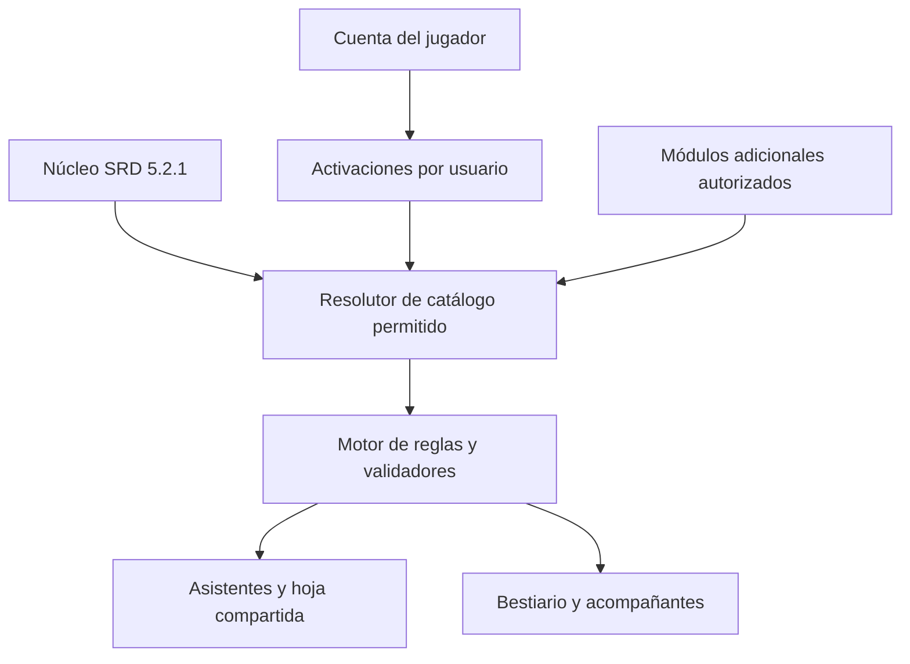

# Arquitectura del programa base SRD y futuros módulos de contenido

**Contrato de referencia, decisión arquitectónica 84 · 27 de noviembre de 2026.**

## 1. Decisión de producto

CrónicasDnD se desarrollará como **editor de personajes D&D 5e 2024 de núcleo estable y contenido ampliable**:

1. **Programa base:** únicamente reglas y materiales publicados en **SRD 5.2.1** bajo Creative Commons Atribución 4.0 Internacional. Este contenido está disponible desde el inicio y no requiere activar expansiones.
2. **Módulos opcionales:** paquetes identificables, versionados y activables por cuenta que aportan clases, subclases, especies, dotes, conjuros, invocaciones, objetos, monstruos u otras fichas. Cada módulo debe disponer de una base de derechos válida para su distribución.
3. **Contenido de usuario (futuro):** datos originales y caseros separados del catálogo oficial, con procedencia visible.

**Estado real en el paso 84:** solo existe el paquete activo `srd-5.2.1`. La activación por usuario, instalación, desinstalación y combinación de paquetes son diseño futuro, **no funcionalidades implementadas**. La declaración de identidad del núcleo está en `packages/rules-engine/src/content-packs.ts`.

**Límite jurídico y técnico:** el hecho de distribuir reglas dentro de un módulo, permitir que cada usuario lo active o no cobrar por el servicio **no autoriza** reproducir libros no incluidos en el SRD. Una extensión comercial requeriría autorización o licencia adecuada; para una aportación casera deben verificarse los derechos del autor. No se incorporarán paquetes no autorizados a los recursos suministrados por el servidor.

## 2. Límites del contenido base verificados

Referencias oficiales: [SRD 5.2.1](https://www.dndbeyond.com/srd), [PDF inglés](https://media.dndbeyond.com/compendium-images/srd/5.2/SRD_CC_v5.2.1.pdf), [PDF español](https://media.dndbeyond.com/compendium-images/srd/5.2/SP_SRD_CC_v5.2.1.pdf).

| Área | Base SRD que implementa el proyecto | Exclusión aplicada en el paso 84 |
| --- | --- | --- |
| Clases y subclases | Guerrero/Campeón 1–20, Mago/Evocador 1–20, Brujo/Patrón Infernal 1–15 (actualización 87) | No se añaden otras subclases del PHB |
| Origen | Humano, elfo, enano, mediano; Acólito, Criminal, Erudito y Soldado | No se añaden especies ni trasfondos externos |
| Dotes de origen | Alerta, Iniciado en la Magia, Ataque salvaje, Competente | Artesano, Sanador, Afortunado, Músico, Peleador de taberna, Duro |
| Estilos de combate | Tiro con arco, Defensa, Combate con arma a dos manos, Combate con dos armas | Combate a ciegas, Duelo, Intercepción, Protección, Combate arrojadizo, Combate sin armas |
| Beneficios épicos | Pericia en combate; también Recuperación de conjuros y Visión verdadera en Mago | Fortaleza y Velocidad |
| Conjuros de Mago | **217 conjuros de los niveles 0–9**, mismos identificadores y niveles que la tabla SRD | 25 conjuros extra; véase registro de auditoría |
| Conjuros de Brujo | Trucos y niveles 1–8 del SRD (Arcanum nivel 8 desde Brujo 15); invocaciones según disponibilidad | 18 referencias de conjuros extra, incluidas tres fichas exclusivas, retiradas en el paso 84 |
| Iniciado en la Magia | Listas SRD de Clérigo, Druida y Mago, trucos y conjuros de nivel 1 | Trucos externos de las tres listas |
| Bestiario | 7 familiares especiales de Pacto de la Cadena y 15 comunes/históricos | Renacuajo slaad |
| Objetos, armas, armaduras y estado | Catálogos y cálculos declarados en el motor, siempre limitados al SRD | No se deben añadir materiales comerciales sin procedencia y validación |

La cantidad de conjuros de clase puede ampliarse mediante módulos en una fase posterior; **el motor de reglas no debe volver a acoplarse a listas procedentes de un manual comercial**.

### Limitaciones funcionales del núcleo

- El Guerrero mantiene un selector de las cuatro dotes de origen; no se eliminan las competencias y las elecciones de `Iniciado en la Magia` o `Competente`.
- Los asistentes del Humano en Mago y Brujo y la invocación `Lecciones de los Primeros` presentan, por ahora, **Alerta y Ataque salvaje**. Ambas son SRD; falta incorporar a esos flujos las elecciones complejas de `Competente` e `Iniciado en la Magia` como mejora **del núcleo**, no de un módulo no-SRD.
- Los beneficios épicos y las dotes generales no implementados se seguirán incorporando exclusivamente cuando figuren en el SRD.
- Se conserva la interfaz y el comportamiento común de subida/bajada de nivel, selección de media o dado de golpe, hoja, tiradas, descansos y fichas de acompañantes.

## 3. Separación futura de las capas

**Núcleo de reglas:** dados, características, competencia, defensa, turnos, inventario, persistencia, resolución de acciones y contrato común de progresión, independientes de la procedencia del contenido.

**Registro de contenidos:** todos los materiales se declaran una sola vez con `packId`, `contentId`, versión y fuente. Una clase referencia conjuros, dotes y monstruos del registro; no mantiene copias paralelas de sus definiciones.

**Vista:** formularios, fichas de criaturas y asistentes consumen únicamente opciones resueltas para la cuenta actual. No hacen supuestos de que un libro esté instalado ni codifican un repertorio exclusivo de una clase.

**Contrato de creación y edición, actualización 88:** toda clase presente o futura ofrece sus elecciones iniciales dentro de `CharacterCreationDialog`, un `<dialog>` accesible y separado de las siete pestañas de la hoja. La ficha comienza oculta mientras no se han confirmado las elecciones; al confirmar, se muestra la pestaña Principal. Editar abre el mismo marco con los valores actuales y permite cancelar restaurando las elecciones anteriores. Ninguna clase debe incrustar su editor en Principal ni modificar elecciones de subidas anteriores desde ese editor. El botón común `CharacterHeader` dice «Subir de nivel» y abre el asistente de progresión específico de la clase, siempre dentro de `LevelUpDialogFrame`. El botón «Guardar elecciones» confirma solamente el borrador de la ficha en memoria; la persistencia en PostgreSQL se sigue ejecutando explícitamente con `SaveLoadPanel`. La hoja y el motor de reglas no requieren cambiar al incorporar módulos autorizados.

**Persistencia:** registrar el identificador lógico y la versión de origen de cada opción adquirida; no duplicar fichas enteras. Las decisiones de progresión y los datos manuales del jugador siempre viven separados del catálogo.

**Procedencia y derechos:** cada paquete debe declarar su título, versión, URL de fuente, licencia, declaración de derechos, dependencias y categorías. `content-packs.ts` define el contrato preliminar. Este metadato **no constituye** por sí mismo autorización de uso: las licencias y los archivos deben revisarse antes de publicarse.

## 4. Resolución, activación y desactivación proyectadas

1. Cargar el paquete base validado, siempre activo.
2. Consultar los paquetes autorizados activados en la cuenta.
3. Validar manifiesto, integridad, dependencias, derechos y compatibilidad de versión.
4. Construir una vista del catálogo por **IDs estables y espacios de nombres**; rechazar colisiones de IDs y definiciones conflictivas.
5. Filtrar opciones por clase, nivel, requisitos, reglas y activación; reutilizar en la interfaz los componentes existentes.
6. Al desactivar un módulo, **no borrar automáticamente los personajes ni sus elecciones**. Marcar referencias como `contenido no disponible`, conservar el dato y ofrecer una migración explícita si procede.

No se aceptarán instrucciones ejecutables, scripts ni JSX dentro de los datos de un módulo. Los contenidos son **datos validados**, y las reglas de cálculo se implementan mediante operaciones declarativas o código propio revisado. Las acciones activas de partida siguen siendo decisión del jugador.

## 5. Plan de migración de personajes existentes

Los personajes creados con versiones anteriores pueden conservar selecciones como `tough`, `fortitude`, `speed`, `slaad_tadpole` o conjuros ya retirados del núcleo.

**Política obligatoria:** no modificar registros de Prisma ni borrar guardados al actualizar el catálogo. Mantener las estructuras de estado antiguas que sean necesarias para poder detectar versiones anteriores; al abrir un personaje, señalar las referencias no disponibles y ofrecer:

- Copia de seguridad/exportación del personaje original.
- Sustitución voluntaria por una alternativa válida del núcleo, preservando el resto de elecciones cuando sea posible.
- Reincorporación futura si un módulo **legalmente autorizado** aporta el ID y las reglas necesarias.

Una conversión automática silenciosa podría alterar PG, ataques, repertorios o la historia de subidas y bajadas de nivel. Esta migración visual aún queda pendiente; mientras tanto, un guardado con una elección retirada puede ser rechazado por la validación actual y debe explicarse al usuario.

## 6. Contratos de pruebas y documentación del TFG

Pruebas obligatorias al incorporar cada módulo: procedencia y derechos; unicidad de IDs; rechazo de opciones no activas; respeto a prerrequisitos; aislamiento entre usuarios; progresión reversible con datos adquiridos; guardado/restauración; ordenación del Bestiario; compatibilidad de fichas y tiradas; y ausencia de mutaciones de datos de módulos durante la partida.

**Prueba base del paso 84:** `packages/rules-engine/tests/srd-base-84.test.ts`. **Revisión de correspondencia con la lista SRD:** `node scripts/audit-srd-spells.mjs <texto extraído del PDF inglés mediante pdftotext -raw>`. El script compara 217 nombres oficiales, niveles e identificadores, con tabla de equivalencias para conjuros cuyos nombres comerciales cambiaron en el SRD.

Para la memoria del TFG registrar: problema de acoplamiento entre reglas y contenido licenciado; normalización de entidades y separación de responsabilidades; migraciones sin pérdida; resolución de dependencias; validaciones y protección frente a datos arbitrarios; pruebas de regresión; limitaciones legales, éticas y técnicas; resultados de cobertura de catálogo base.

## 7. Atribución del contenido SRD

Esta obra incluye material procedente del documento de referencia del sistema 5.2.1 («SRD 5.2.1») de Wizards of the Coast LLC, disponible en https://www.dndbeyond.com/srd. La licencia del SRD 5.2.1 se concede de acuerdo con la licencia internacional de Atribución 4.0 de Creative Commons, disponible en https://creativecommons.org/licenses/by/4.0/legalcode.

Se han realizado selecciones, adaptaciones de presentación, denominaciones y resúmenes propios en español, junto con cálculos y mecanismos de interacción originales. Deben mantenerse esta atribución, los enlaces a la licencia y la indicación de modificaciones en la distribución y la interfaz «Acerca de» del programa, así como verificar la redacción exacta requerida por la licencia aplicable.
