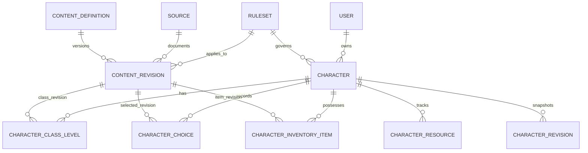

# Modelo de datos v0.1 — D&D Character Builder

**Estado:** diseño propuesto, pendiente de implementación y revisión.  
**Edición inicial:** D&D 2024. **Hitos:** M1 (Guerrero 1) y M2 (Guerrero 2–3, Campeón).  
**Fuentes:** *Player's Handbook* 2024 aportado por el usuario; SRD 5.2.1.  
**Dependencias documentales:** `docs/requisitos/ALCANCE_MVP.md`, `INVENTARIO_CONTENIDOS.md` y `GUERRERO_NIVELES_1_3.md`.

> Este documento define contratos y relaciones; **no crea tablas reales**, no importa el manual ni incluye código de producción. No guardar textos extensos del PHB en el repositorio sin permiso de redistribución. Conservar la procedencia y el estado de derechos por entrada.

## 1. Principios no negociables

1. **Definición ≠ elección ≠ estado ≠ resultado.** La clase define opciones; el personaje guarda lo que eligió; el estado guarda PG actuales y usos disponibles; el motor calcula PG máximos y modificadores.
2. El contenido tiene **ID estable** y **revisiones inmutables**. Un personaje referencia la revisión utilizada, no solo el nombre del elemento.
3. No duplicar el mismo elemento porque se encuentre en dos fuentes; mantener una identidad conceptual y registrar cada origen/revisión según proceda. No asumir que dos versiones son equivalentes sin cotejarlas.
4. La edición `dnd-2024` se almacena explícitamente. Compatibilidad con `dnd-2014` se prevé, pero no se implementa todavía.
5. Los efectos automáticos son **operaciones declarativas permitidas** (JSON validado), nunca scripts ejecutados por un usuario.
6. El servidor valida referencias, selecciones y permisos; el motor es una biblioteca TypeScript independiente de Prisma/Next.js.
7. Los datos persistidos tienen trazabilidad; los cálculos pueden reconstruirse y explicarse a partir de las elecciones y versiones.

## 2. Diagrama de relaciones (conceptual)



**Nota:** `CHARACTER_CHOICE` puede apuntar a una revisión o contener una selección tipada simple (por ejemplo, escoger Fuerza). Las referencias y tipos se validan según el contrato de cada elección; no todas las elecciones son un `contentRevisionId`.

## 3. Tablas propuestas

| Tabla | Campos importantes (conceptuales) | Responsabilidad |
|---|---|---|
| `users` | `id`, `auth_provider_id`, `created_at` | Propietario; identidad externa al motor. |
| `rulesets` | `id`, `code`, `version`, `status` | Ej.: `dnd-2024`. |
| `sources` | `id`, `title`, `kind`, `edition`, `license_code`, `distribution_policy`, `reference_url` | Procedencia y restricciones. |
| `content_definitions` | `id`, `slug`, `content_type`, `canonical_name` | Identidad estable: clase, especie, dote, rasgo, conjuro, arma, etc. |
| `content_revisions` | `id`, `definition_id`, `revision_number`, `ruleset_id`, `source_id`, `schema_version`, `mechanics_json`, `publication_status`, `created_at` | Definición inmutable versionada; descripciones solo si hay permiso. |
| `characters` | `id`, `owner_id`, `ruleset_id`, `name`, `status`, `created_at`, `updated_at` | Identidad y edición del personaje. |
| `character_abilities` | `character_id`, `ability`, `base_score`, `generation_method`, `generation_evidence_json` | Las puntuaciones **antes** de aumentos del trasfondo y demás efectos. |
| `character_class_levels` | `id`, `character_id`, `class_revision_id`, `class_level`, `taken_at_character_level`, `hp_increase_method`, `hp_die_roll` | Historial de niveles; una entrada por nivel adquirido. |
| `character_choices` | `id`, `character_id`, `choice_key`, `granted_by_revision_id`, `made_at_level`, `value_json`, `selected_revision_id`, `status` | Elecciones reproducibles, incluidas competencias, estilo, arma de maestría, trasfondo y especie. |
| `character_inventory_items` | `id`, `character_id`, `item_revision_id`, `quantity`, `equipped`, `attuned`, `notes` | Posesiones, distintas de la *competencia* con tipos de armas. |
| `character_resources` | `id`, `character_id`, `resource_key`, `current_uses`, `source_revision_id`, `updated_at` | Usos restantes; el **máximo** es calculado por el motor. |
| `character_state` | `character_id`, `current_hp`, `temporary_hp`, `death_save_successes`, `death_save_failures`, `conditions_json`, `updated_at` | Estado mutable que no debe cambiar al recalcular atributos. |
| `character_revisions` | `id`, `character_id`, `schema_version`, `snapshot_json`, `reason`, `created_at` | Historial y recuperación posterior (no indispensable en M1). |

### Restricciones propuestas

- Claves foráneas en identificadores relacionados; índices por `character_id`, `owner_id`, `definition_id`, `ruleset_id`.
- Unicidad de `content_revisions(definition_id, revision_number)` y de `rulesets(code, version)`.
- Para `character_abilities`, una fila por característica por personaje; `ability` restringido al conjunto de seis.
- `character_class_levels` debe impedir repetir `taken_at_character_level` dentro del mismo personaje; permitir varias filas de la misma clase al progresar.
- Los valores de `current_hp`, `current_uses` y cantidades deben someterse a validación de dominio; puede ser legítimo que `current_uses` baje a 0, nunca debería ser negativo.
- La autorización **se comprueba siempre por propietario** en las operaciones de personajes, incluso cuando el identificador sea conocido.
- Las revisiones publicadas de contenido no se editan in situ; se crea una nueva revisión y se migra explícitamente cuando corresponda.

## 4. Cómo representar el Guerrero de niveles 1–3

### Definición de clase (esquema ilustrativo, NO carga del manual)

```json
{
  "definitionId": "class:fighter",
  "revisionId": "class:fighter@2024-r1",
  "ruleset": "dnd-2024",
  "source": "srd-5.2.1",
  "kind": "class",
  "mechanics": {
    "hitDie": 10,
    "savingThrowProficiencies": ["strength", "constitution"],
    "levelFeatures": {
      "1": ["feature:fighting-style", "feature:second-wind", "feature:weapon-mastery"],
      "2": ["feature:action-surge", "feature:tactical-mind"],
      "3": ["choice:fighter-subclass"]
    }
  }
}
```

**Importante:** `feature:*` son referencias a revisiones de rasgos, no descripciones copiadas. Una elección como Estilo de combate se almacena en `character_choices`; los usos de Segundo aliento en `character_resources`.

### Contrato ilustrativo de efecto

```json
{
  "effectType": "grant_proficiency",
  "target": "saving_throw:strength",
  "when": { "kind": "always" },
  "originRevisionId": "class:fighter@2024-r1"
}
```

El motor deberá usar un catálogo cerrado de operaciones, con validadores que rechacen campos desconocidos, referencias inexistentes o ciclos de dependencia.

## 5. Ejemplo mínimo de personaje (esquema de intercambio, no filas SQL)

```json
{
  "characterId": "character:demo-001",
  "ruleset": "dnd-2024",
  "name": "Ardan",
  "baseAbilities": {
    "strength": 15,
    "dexterity": 12,
    "constitution": 14,
    "intelligence": 10,
    "wisdom": 10,
    "charisma": 8
  },
  "classLevels": [
    { "classRevisionId": "class:fighter@2024-r1", "characterLevel": 1, "classLevel": 1 }
  ],
  "choices": [
    { "key": "species", "selectedRevisionId": "species:human@2024-r1" },
    { "key": "background", "selectedRevisionId": "background:soldier@2024-r1" },
    { "key": "background-ability-boost", "value": { "strength": 1, "dexterity": 1, "constitution": 1 } },
    { "key": "fighter-fighting-style", "selectedRevisionId": "feat:example-fighting-style@2024-r1" },
    { "key": "fighter-weapon-mastery", "value": ["weapon:greatsword", "weapon:longbow", "weapon:longsword"] }
  ],
  "state": {
    "currentHp": 12,
    "temporaryHp": 0,
    "resources": { "second-wind": 2 }
  }
}
```

**Datos de muestra ficticios:** la distribución de atributos y el conjunto de elecciones son demostrativos y deben validarse respecto al trasfondo, especie, método de puntuaciones y requisitos antes de utilizarlos como personaje válido. El `style` es un identificador de ejemplo no publicable. No confundir este JSON agregado con el diseño de tablas.

## 6. Qué se guarda y qué calcula el motor

| Guardamos (fuente de verdad) | Calculamos (vista derivada) |
|---|---|
| Puntuaciones base y método; aumento elegido por trasfondo | Puntuaciones finales y modificadores |
| Secuencia de niveles de clase y elección de PG por nivel | Nivel total, bonificador de competencia, PG máximos |
| Identificadores **de revisión** para clase, subclase, especie, trasfondo, dotes y objetos | Rasgos activos y competencias resultantes |
| Selección de habilidades, estilo y maestrías | Salvaciones, habilidades, iniciativa y ataques |
| Inventario, equipado, sintonizado | CA y otros efectos de equipo |
| PG actuales, PG temporales y recursos restantes | Máximos de recursos, condiciones para recuperar usos |
| Eventos confirmados que modifican el estado | Explicación de procedencia de cada modificador |

### Caso de cuidado: cambios de Constitución

Si Constitución sube, los PG máximos pueden aumentar retrospectivamente. Por eso deben guardarse las tiradas (o decisión de aumento fijo) **por nivel** y recalcular el máximo, en vez de guardar únicamente un total fijo que no pueda reconstruirse. La aplicación no debe modificar los PG actuales sin una política explícita.

### Caso de cuidado: personajes que suben de nivel

Una subida de nivel debe abrir una **transacción**: validar decisiones y recursos, registrar el nuevo nivel, guardar elecciones, recalcular y confirmar todo junto. Si una decisión es inválida, no se guarda un personaje a medio subir de nivel.

## 7. Revisiones, idiomas y licencias

- `content_definitions` ofrece identidad independiente de idioma; las etiquetas se obtienen de tablas/localizaciones, inicialmente `es` y `en`.
- `sources` conserva metadatos de cada origen; los textos autorizados pueden almacenarse de forma separada (`content_localizations`) con condiciones de distribución explícitas.
- Una definición de referencia en el PHB no se incorpora automáticamente con su texto íntegro. Se pueden almacenar identificadores, datos mecánicos propios y referencias bibliográficas según derechos aplicables.
- La revisión de contenido se fija en las elecciones. Si se publica `r2`, el usuario podrá revisar su migración; no se cambia silenciosamente `r1` por `r2`.
- Los imports JSON incluyen `schemaVersion`, identificadores estables y un reporte de referencias ausentes al restaurar.

## 8. Orden recomendado de implementación

1. Crear migraciones para `users`, `rulesets`, `sources`, `content_definitions`, `content_revisions`.
2. Añadir `characters`, `character_abilities`, `character_class_levels`, `character_choices`.
3. Añadir inventario, recursos y estado mutable.
4. Crear validadores TypeScript/Zod de elecciones, referencias y efectos.
5. Insertar **datos mínimos autorizados** para Guerrero 1, tres especies y cuatro trasfondos del MVP.
6. Guardar y recuperar un Guerrero sin calcular todavía toda la hoja.
7. Integrar el motor e introducir los cálculos y tests de `GUERRERO_NIVELES_1_3.md`.

## 9. Criterios de aceptación del diseño (antes del código)

- [ ] Se puede representar un Guerrero nivel 1 sin incrustar sus reglas en el registro del personaje.
- [ ] Se pueden registrar las 3 maestrías elegidas separadas de las armas físicas poseídas.
- [ ] Se pueden registrar los usos de Segundo aliento sin persistir su máximo como verdad fija.
- [ ] Un Guerrero nivel 3 puede referenciar la revisión de Campeón elegida.
- [ ] Un cambio de equipo permite recalcular CA sin sobrescribir las elecciones previas.
- [ ] Una nueva revisión de una dote no altera un personaje existente.
- [ ] Todas las entradas tienen procedencia y reglas de distribución identificables.
- [ ] La base permite añadir otras clases, conjuros y homebrew sin reestructuración fundamental.
- [ ] Las entradas JSON se validan y no ejecutan código del usuario.

## 10. Decisiones pendientes antes de escribir Prisma

- **Identificadores físicos:** se propone UUID para filas y claves de negocio legibles para contenido; decidir la convención exacta.
- **Inicio de sesión:** Supabase Auth sigue siendo la elección preliminar; confirmar cómo enlazar `users.id` con `auth.users.id`.
- **Revisiones:** decidir si para los personajes M1 se guardarán snapshots completos o solo cambios; sugerencia: snapshot en hitos, más adelante registro de eventos.
- **Almacenamiento de efectos:** JSONB validado en la aplicación y con versiones de esquema; columnas relacionales para búsquedas principales.
- **Texto del manual:** no almacenar transcripciones de texto protegido sin contar con los derechos pertinentes.

**Siguiente documento:** `docs/architecture/MOTOR_REGLAS_CONTRATOS_V01.md`, con operaciones, resolución de modificadores y casos de prueba del Guerrero. Luego implementar las primeras migraciones de Prisma.
